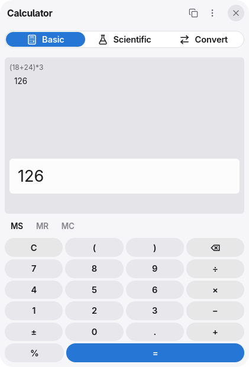
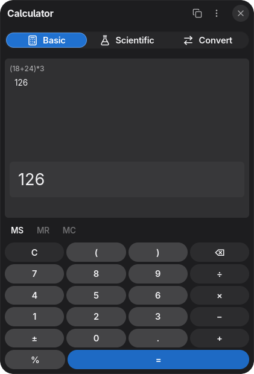
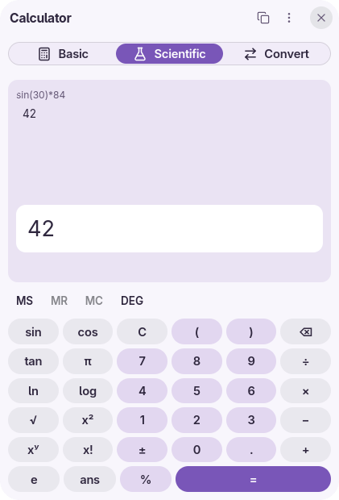
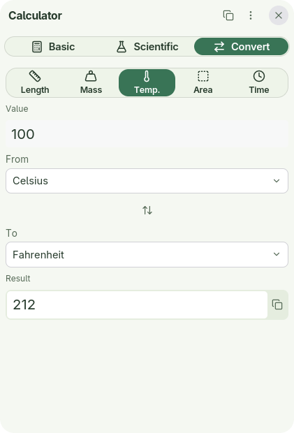
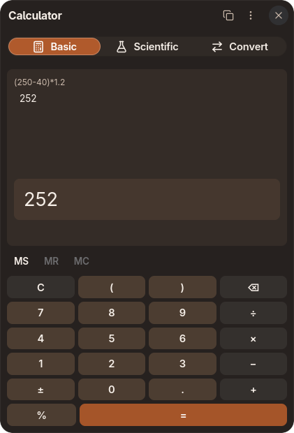
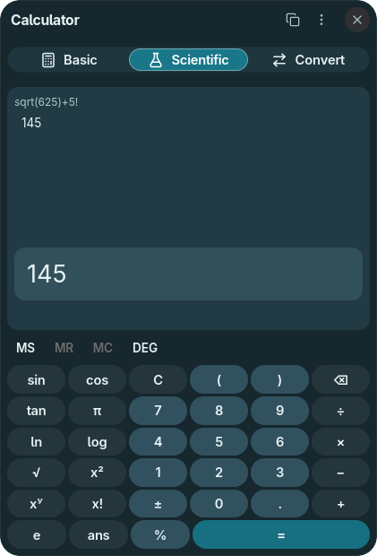
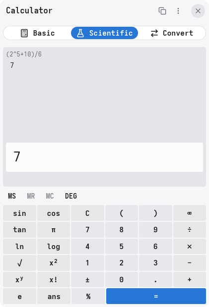
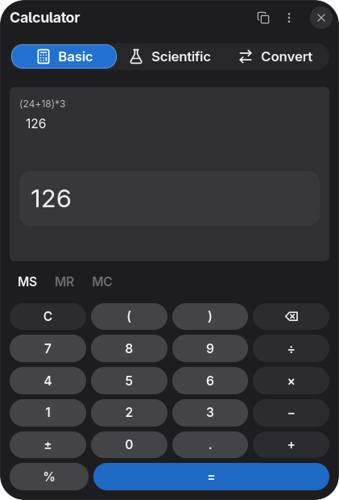

# Calculator

A native Linux calculator built with [enzUI](https://github.com/enz1m/enzui).
Evaluate expressions, use scientific functions and convert units in a compact
window that follows your desktop's theme.

<table>
  <tr>
    <td align="center">
      <a href="docs/screenshots/basic-light.png"></a>
      <br><sub>Default · Light</sub>
    </td>
    <td align="center">
      <a href="docs/screenshots/basic-dark.png"></a>
      <br><sub>Default · Dark</sub>
    </td>
    <td align="center">
      <a href="docs/screenshots/lavender.png"></a>
      <br><sub>Lavender</sub>
    </td>
    <td align="center">
      <a href="docs/screenshots/sage.png"></a>
      <br><sub>Sage</sub>
    </td>
  </tr>
  <tr>
    <td align="center">
      <a href="docs/screenshots/ember.png"></a>
      <br><sub>Ember</sub>
    </td>
    <td align="center">
      <a href="docs/screenshots/lagoon.png"></a>
      <br><sub>Lagoon</sub>
    </td>
    <td align="center">
      <a href="docs/screenshots/precision.png"></a>
      <br><sub>Precision</sub>
    </td>
    <td align="center">
      <a href="docs/screenshots/comfort.png"></a>
      <br><sub>Comfort</sub>
    </td>
  </tr>
</table>

Click a screenshot to view it at full size.

## Features

- Expressions with precedence, parentheses, powers, percentages and memory.
- Scientific functions, factorial, π, e, previous answer, degrees and radians.
- Length, mass, temperature, area and time conversion; expressions work as inputs.
- Live results, selectable results and reusable calculation history.
- Native text drag and drop, clipboard, keyboard shortcuts and accessible controls.
- Light and dark themes, desktop text scaling, English, German and Arabic.

## Build and run

Linux with Rust **1.99.1**, a C compiler, pkg-config and Wayland development
libraries is required. The minimum supported Rust version is **1.95**.
On Arch Linux, install `base-devel rustup pkgconf wayland libxkbcommon fontconfig`.
On Ubuntu, use `build-essential pkg-config libwayland-dev libxkbcommon-dev
libfontconfig1-dev`. Install a Vulkan driver or Mesa software renderer for the
default GPU backend. The repository's toolchain file selects Rust automatically.

```sh
git clone https://github.com/enz1m/calculator.git
cd calculator
cargo fetch --locked
cargo build --locked
cargo run --locked
```

The app uses [enzUI Alpha 0.1](https://github.com/enz1m/enzui/releases/tag/v0.1.0-alpha.1)
and pinned public enzim forks. Cargo downloads all sources; no framework
submodule, sibling checkout or private SDK is needed. Commit Cargo.lock when
updating dependencies. Wayland is the default; build with `--features x11` for
X11 sessions.

## Theme and storage

The app follows the shared enzUI theme at `$XDG_CONFIG_HOME/enzui/theme.toml`
(normally `~/.config/enzui/theme.toml`). An adjacent
`org.enzimos.Calculator.toml` can override Calculator's tokens. Both reload live. Text follows the desktop font
or the theme override. Run with `--light` or `--dark` for a session override.

The latest 100 calculations are stored in
`$XDG_DATA_HOME/enz-calculator/history.json` (normally
`~/.local/share/enz-calculator/history.json`). Clear history removes them.
Memory is session-only. History writes are atomic; a lock prevents competing
writers. Invalid, oversized, symlinked or non-regular history files are preserved
and saving is disabled for that session. A second launch activates the running
window when a session bus is available. The app uses no network services.

## Development checks

```sh
cargo fmt --all -- --check
cargo test --locked
cargo clippy --locked --all-targets -- -D warnings
```

Licensed under [MIT](LICENSE).
